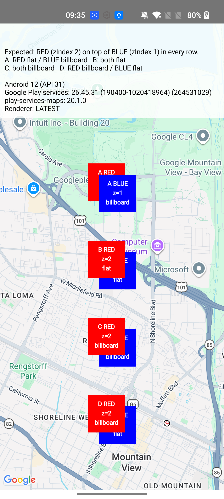

# Maps SDK for Android: zIndex ignored between flat and billboard markers

Minimal reproduction for a marker draw-order regression in the Maps SDK for Android
(Google Play services maps module).

## Problem

`Marker.zIndex` is documented as: *"Markers are drawn in order of the zIndex, with the highest
zIndex marker drawn on top."* Since a Google Play services update in November 2026 this no longer
holds when a **flat** marker (`MarkerOptions.flat(true)`) and a **non-flat (billboard)** marker
overlap: the zIndex between the two groups is ignored. Within one group (all flat, or all
billboard) zIndex still works.

No app code changed — the behavior changed after the Play services update. It is not
device-specific: expect it to reproduce on any device running the updated maps module.

## The repro

A single Activity with a plain `MapView` (no Compose, no `maps-compose`, no utility libraries) and
four rows of two overlapping markers at the same `LatLng`. In every row:

- **RED** has `zIndex = 2` → must be drawn on top
- **BLUE** has `zIndex = 1` → must be drawn below
- RED is added **first**, so insertion order alone would put BLUE on top; only zIndex can make RED win

| Row | RED (zIndex 2) | BLUE (zIndex 1) | Expected       |
|-----|----------------|-----------------|----------------|
| A   | flat           | billboard       | RED on top     |
| B   | flat           | flat            | RED on top (control) |
| C   | billboard      | billboard       | RED on top (control) |
| D   | billboard      | flat            | RED on top     |

Each marker's label shows its color, zIndex and flat/billboard mode. The panel at the top shows
the Android version, Google Play services version, `play-services-maps` version and the
renderer in use.

### Expected

RED on top of BLUE in all four rows.

### Actual

- **Row A is wrong:** BLUE (billboard, zIndex 1) is drawn on top of RED (flat, zIndex 2).
- Rows B, C and D are correct.

So when flat and billboard markers overlap, the billboard marker is always drawn on top
regardless of zIndex. Row D is correct only because the billboard marker also has the higher zIndex.



## Environment

| | |
|---|---|
| `play-services-maps` | 20.1.0 |
| Renderer | LATEST |
| Google Play services | 26.45.31 |
| Maps core module | `264320701` |

The maps core module version shows in logcat stack frames as
`com.google.android.gms.policy_maps_core_dynamite@<version>`.

## Build and run

1. Put a Maps SDK for Android API key in `local.properties`:
   ```
   MAPS_API_KEY=your_key
   ```
   (or pass `-PMAPS_API_KEY=your_key`). If the key is restricted, allow the package
   `com.example.mapszindex` with your debug signing certificate's SHA-1.
2. `./gradlew :app:installDebug`
3. Launch **Flat marker zIndex repro**.

## Workaround

Make all overlapping markers the same kind — all flat or all billboard — so zIndex applies again.
